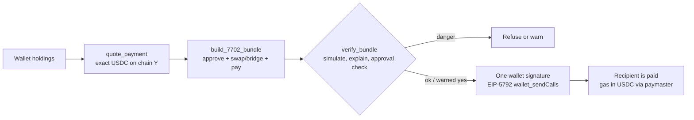

# SwapChan Roadmap: Staying Relevant

The product bet is EIP-7702 plus stablecoin payments: one signature to pay exact USDC on a chosen chain from whatever the wallet holds, with gas paid in USDC. Simulate, explain, and check approvals stay the required safety layer under that. This page is written against the 74 MCP tools on main and on the live server, not against a wish list.

## Contents

- [The bet](#the-bet)
- [Milestone 1 — one same-chain payment](#milestone-1--one-same-chain-payment)
- [What already exists](#what-already-exists)
- [Current MCP tools](#current-mcp-tools)
- [Gaps against the bet](#gaps-against-the-bet)
- [Proposed tools](#proposed-tools)
- [Ranked by impact](#ranked-by-impact)
- [Other audit findings](#other-audit-findings)
- [Sources](#sources)

## The bet

**One signature, exact USDC out, gas in USDC.**

SwapChan already compares routes and returns unsigned transactions. The gap that matters is turning that into a payment: pay X USDC on chain Y to Z, sourced from whatever the wallet holds, approve plus swap or bridge plus the payment in one EIP-7702 bundle, with gas sponsored in USDC. An agent can only offer that if the bundle is simulated, explained, and approval-checked before the wallet sees it. Human sign-off on that one signature stays the default.

EIP-7702 (Set code for EOAs) shipped in the Pectra upgrade on Ethereum mainnet on 7 May 2025, 10:05:11 UTC, epoch 364032. The Ethereum Foundation's announcement names the two capabilities this roadmap needs: atomic batching (approve and swap in one transaction) and gas sponsorship. 7702 itself is not a paymaster; a delegate plus a wallet API such as EIP-5792 `wallet_sendCalls` (which can carry a paymaster capability) is how those land in a wallet. I did not verify 7702 support on SwapChan's other eight EVM chains, so a bundle should be offered only on a chain that has been checked.

For THORChain routes from Litecoin, Dogecoin and Bitcoin Cash, MCP returns the unsigned PSBT, wallet signing instructions and the tracking tool that accepts the inbound transaction ID. Tron deposits show the vault, amount in sun and required memo. The API and web tracker distinguish a provider-reported refund on the source chain from a destination payout. The refund path has API fixture coverage. A SwapChan-initiated exact-USDC payment from a non-EVM wallet remains open.

For Solana-origin swaps, the web wallet compiles the reviewed instructions or decodes the provider transaction, checks the fee payer and simulates the transaction with its original blockhash before requesting a signature. MCP can simulate a serialized quote directly. For an instruction-list quote, the wallet must compile it first and pass the serialized transaction to `simulate_swap`. Simulation covers source execution only. Live Solana payment settlement remains unverified.

For a native TRX swap to Ethereum USDC, `get_route_status` can verify a historical payout against both chains. In the verified example, one Tron signature sent 6.726933 TRX with a 1 TRX transaction fee. The Ethereum router referenced that Tron transaction in its outbound memo and paid 1.765526 USDC to the recipient named in the inbound memo. Ethereum block 26,493,279 finalized. This replays a public swap with variable output. [Confirmed Tron deposit](https://tronscan.org/#/transaction/3d78de8c3b44ba21cb6aa3eaa5dd9f4890b57302f66654f97487755865920e7c) · [Ethereum payout](https://etherscan.io/tx/0xb0912b9de14422e0160b6c000cfafbb2189fde75a1975cec7710a104fccb2e47)

For a native TRX refund to the original sender, MCP checks both confirmed Tron transactions and the inbound transaction ID in the refund memo. A historical 7,600 TRX deposit returned 7,598.639214 TRX to the depositor. The swap status remains failed and the verified amount is available in `tronRefund.returnedSun`. [Deposit](https://tronscan.org/#/transaction/ac7a2d63a4d06fe133d10cddee5e360ee50f8ce30091f9f61925a5bb37795e1e) · [Refund](https://tronscan.org/#/transaction/16dc4f1e80aedcdd784ffab9926ebd1a7306cf5b7a0546ab312f41c88cc37b03)

## Milestone 1 — one same-chain payment

### Payment coverage on this branch

| Payment path                                          | What the caller signs                                                                             | Fees and settlement evidence                                                                                                               |
| ----------------------------------------------------- | ------------------------------------------------------------------------------------------------- | ------------------------------------------------------------------------------------------------------------------------------------------ |
| Base Sepolia WETH or USDC to exact local USDC         | First use requires delegation and a payment signature. Repeat use requires one payment signature. | The USDC paymaster covered native gas on both recorded payments. The receipt checks the recipient’s exact gain and the paymaster charge.   |
| Base Sepolia USDC or WETH to Optimism Sepolia USDC via Circle | The native-gas run signed an approval and burn. The delegated sponsored runs each used one payment signature. | Native-gas and sponsored USDC runs delivered an exact micro-USDC. The WETH-funded sponsored origin receipt records the swap, forwarding fee and paymaster charge. |
| Base Sepolia USDC to Optimism Sepolia USDC via Across | Approval when needed, then deposit. An eligible delegated account can batch the origin calls.     | Origin gas is paid in ETH. The recorded testnet deposit expired. MCP distinguishes destination settlement from an origin refund.           |
| Local Optimism USDC transfer                          | A funded EOA signs one ERC-20 transfer.                                                           | Sepolia builds simulate the transfer. The receipt verifier matched a historical mainnet transfer. Mainnet builds are disabled.             |
| Solana, Tron and UTXO-origin swaps                    | The swap tools return chain-specific signing material or deposit instructions.                    | These source assets are outside the exact-USDC `pay` builder. A swap quote’s expected output is insufficient evidence of an exact payment. |

Circle testnet quotes check whether a delegated sender has enough USDC for the payout, Circle forwarding fee and Pimlico gas cap. For a funded sender, the API requests paymaster data and a bundler estimate for the approval, burn and capped paymaster approval. At Base Sepolia block 0x3c94327, the zero-ETH sender held 0.010723 USDC. Paying 0.000001 USDC with a 0.057847 USDC forwarding fee and a 0.015305 USDC gas cap required another 0.062430 USDC. The quote stopped at the balance check. The sponsored path now has a separate quote ID for MCP build and verification, local EIP-712 signing, relay and receipt tracking. Gas limits include the larger pre-verification estimate on Base. The tracker scopes the burn and paymaster charge to the signed operation before checking the destination mint. The sponsored origin receipt is recorded below.

A sponsored Circle payment for 0.000001 USDC used one EIP-712 payment signature on the previously delegated account. Its Base Sepolia balance fell from 0.127266 to 0.038520 USDC and its native balance stayed at zero. Circle took 0.056079 USDC for forwarding and the paymaster charged 0.032666 USDC for origin gas. The MCP status path matched the burn and paymaster events within the operation. Circle subsequently minted exactly 0.000001 USDC on Optimism Sepolia. The recipient went from 0.000001 to 0.000002 USDC with zero native ETH before and after. The tracker subsequently returned `settled` with both canonical receipts finalized. [Destination mint](https://sepolia-optimism.etherscan.io/tx/0xed6db447d8bf35ca31d01ffaa9d76d15f9b0318f51a14926d58064e1bc4eff4a) [Sponsored origin receipt](https://sepolia.basescan.org/tx/0xc7e7b8651255db307a88fa92da28eb85f2958ad73df87b6d1c063cd97ff712bd)

A fresh Base Sepolia account can request a sponsored Circle payment before delegation. For a live 0.000001 USDC quote, the bridge budget was 0.051760 USDC and the paymaster cap was 0.056341 USDC. The MCP returns the reviewed payment and the pending chain-specific delegation. After the wallet supplies that authorization, the build and verification steps must simulate the sponsored origin before returning the payment signature request. This first-use cross-chain check reached the unsigned delegation at nonce 13. The mined sponsored examples used an already delegated sender.

Sponsored Circle quotes can now source a USDC shortfall from Base Sepolia WETH or wrap native ETH before the swap. A successful bundler simulation makes this route eligible for cost comparison. The first receipt used existing USDC. In a second live run the zero-ETH sender started with 0.038520 USDC, below the quoted bridge and paymaster budget. The funder wrapped and transferred 1,388,263,465,725 wei of WETH to the sender. The reviewed cap was 1,807,392,111,659 wei of WETH and 0.055676 USDC for gas. One local payment signature authorized the origin batch. The swap spent 1,796,576,793,378 wei of WETH for 0.069768 USDC. Circle took 0.052611 USDC to forward the 0.000001 USDC payout, and the paymaster took 0.034029 USDC. The sender ended with 0.021647 USDC and zero ETH. The origin finalized. The Optimism Sepolia mint raised the recipient from 0.000002 to 0.000003 USDC with zero ETH before and after. The tracker returned `awaiting_finality` for the destination. [Destination mint](https://sepolia-optimism.etherscan.io/tx/0x5963900faccd0839b5c94698d089962dfb774d60b3de698ae72bd08a5d1c4681). [WETH funding](https://sepolia.basescan.org/tx/0x3a5902923ec979e76f7ce08c56975121b5a9978c26b978900d54cff8e1716412) · [Swap and burn](https://sepolia.basescan.org/tx/0xc35bef44c15de798a014e6fa3e6699f3836260aa69434d59d58ad9b1bec1811e)

For a verified sponsored payment, MCP `pay` returns a public build file and offline Block Tools inspection and signing arguments. The signer reconstructs the batch from the reviewed sender, recipient and spending caps. A Circle payment also binds the Optimism Sepolia destination, burn calldata hash, refund address and maximum bridge spend. A native wrap requires an explicit wei amount. In an offline replay with the fixture’s expiry advanced, Block Tools reproduced the WETH-funded operation hash and rejected a changed bridge cap. The live payment used the earlier local signer.

For a Solana sender and Optimism mainnet destination, MCP `pay` and `quote_payment` accept source chain 792703809 and destination chain 10. The API discovers native SOL and funded SPL Token holdings, quotes up to six entries, and accepts an individual `sourceMint` for further holdings. It recomputes the Relay order ID and checks the exact output, recipient, refund terms, deadline, deposit program, instruction amount and order ID. It compiles the deposit and checks the source wallet’s simulated SOL and token changes. At Solana slot 473826598 a read-only quote for 1 Optimism USDC simulated a debit of 14,890,373 lamports plus 5,000 lamports in network fees. The message required one signer. No mainnet transaction was signed. Source simulation and a quoted destination payout do not prove settlement.

Solana comparisons now price each successfully simulated source debit, including the network fee, and return the recommended mint. In a read-only comparison for exactly 1 Optimism USDC, spending 1.020249 Solana USDC plus the SOL fee was estimated at $1.02049. Spending 0.014869540 SOL plus the fee was estimated at $1.02158. The API recommended USDC among those two simulated holdings.

Each simulated Relay quote includes a saved review ID for MCP `payment_status.solana`. The tracker checks the mined Solana message, signer, fee and token debits against the review. Relay links the two transaction hashes. The tracker reads the canonical Optimism receipt and verifies the recipient’s exact net gain, then waits for finality. A historical replay with expectations reconstructed from public receipts matched a debit of 80.788413 Solana USDC and 60,213 lamports in fees to a payout of 80.750221 Optimism USDC. This was an existing transaction. [Solana deposit](https://solscan.io/tx/rm9LoRNKbACSXukGQxudCaapzQJt5yB3vXb5ELjoBNZQxNWgU7JE2ES5qVKM2bZFZjpTT2QpmconKjFvvGUVbmR) · [Optimism payout](https://optimistic.etherscan.io/tx/0x976f435641f406197519b29866be8c476a9855a60df51d6a31288a25b079f375)

MCP `pay` and `quote_payment` also accept Bitcoin source chain 8253038 and Optimism destination chain 10. A read-only order for exactly 1 USDC used six confirmed, unspent Bitcoin outputs. The proposed transaction spent 1,736 sats on the deposit and 2,292 sats on the miner fee, for 4,028 sats total. The API verifies the order ID, refund and payout terms, OP_RETURN, previous output values and scripts, and change back to the sender. Bitcoin execution remains gated because Relay’s /chains API and its network repository identify different depositories. The quote returns amounts without signing material.

Native TRX funding quotes use source chain 728126428 and Optimism destination chain 10. The API checks the exact-output Relay order, refund recipients, pinned Tron depository and deposit calldata, then simulates the call and matches its deposit event to the sender, amount and order ID. A live read-only quote for 1 Optimism USDC simulated a 3.367180 TRX deposit using 1,875 energy units. The one-signature transaction was estimated at 349 bandwidth bytes. Paying both resource costs in TRX would cost 0.536500 TRX, bringing the estimate to 3.903680 TRX before available resource credits. MCP returns a saved review ID for `payment_status.tron`. The tracker checks the finalized Tron deposit, emitted order ID, signature count and actual network fee, then independently checks the Optimism recipient’s net USDC gain and destination finality. A live unsigned quote returned `awaiting_origin_receipt`. A SwapChan-initiated Tron settlement remains open. [TRON bandwidth accounting](https://developers.tron.network/docs/faq)

For an Optimism mainnet payout, `pay` accepts `intent.fundingAddresses` with any combination of EVM, Solana, Bitcoin and Tron addresses. One request compares available holdings and returns each source review and an estimated total cost in USD. In a live read-only comparison for 1 USDC, Solana USDC cost an estimated $1.02048, SOL $1.02314 and TRX $1.18550. The Bitcoin quote was $2.38773 and excluded by its depository gate. The supplied EVM address could not fund the direct Optimism or Base bridge routes. The recommendation was Solana USDC. Mainnet construction and signing remain gated.

For Optimism Sepolia, `pay` accepts the caller's supported transaction and typed-data signing methods by chain in `walletMethodsByChain`. After reviewing the comparison, the caller can pass its `reviewId` to build the recommended compatible route. An empty capability map produces no recommendation. The MCP checks the saved intent and simulation before returning the wallet RPC method and arguments. For sponsored operations it independently reconstructs the EIP-712 payload and checks the operation hash, then provides the submission arguments for the resulting signature. A live MCP call with only Base Sepolia transaction signing available selected Circle, retrieved the saved comparison, and returned its simulated approval as an `eth_sendTransaction` request.

For a verified Across atomic origin build, callers may pass the signing account's `wallet_getCapabilities` result as `walletCapabilities`. With atomic support on Base Sepolia, `pay` returns an EIP-5792 `wallet_sendCalls` request containing the checked approval and deposit with `atomicRequired: true`. The wallet returns a batch ID. Pass its `wallet_getCallsStatus` result into `payment_status.crossChain.walletCallsStatus`. The MCP requires one successful atomic receipt and then verifies the Across deposit and destination payout on-chain. This wallet transport has local coverage. A live EIP-5792 wallet submission remains open. [EIP-5792](https://eips.ethereum.org/EIPS/eip-5792)

On Base Sepolia, the sponsored route can also wrap native ETH inside the payment batch when the sender has insufficient WETH. The quote includes the ETH amount to wrap. The router cap includes the newly wrapped WETH, and the paymaster still charges USDC. A live quote for a wallet holding 19.984022 USDC, zero WETH and 0.000117512143599005 ETH priced a 19.984023 USDC payment with a 392,073,794,024 wei wrap. This additional funding path has quote and batch-construction evidence; a mined wrap-and-pay receipt remains open.

Payment status checks canonical inclusion and finality. Finalized status includes historical sender ETH, WETH and USDC balances and recipient USDC balances when available. The verifier checks the recipient's net USDC gain within the UserOperation.

**Release gates.** Test deployments enable the payment API with `SWAPCHAN_TESTNET_PAYMENTS=1`. Mainnet builds remain disabled. Packaging [Block Tools #108](https://github.com/TSavo/blocktools/pull/108) is a release prerequisite.

The API server persists unexpired quotes and simulated bundles in `payments.db` under `SWAPCHAN_DATA_DIR` (default for payment storage is `~/.swapchan`). The ERC-20 paymaster collects its fee after account execution, so its unused USDC allowance can outlive the payment. A sender with zero ETH needs gas for this cleanup. Receipt status also reports allowance at the receipt block when the RPC can supply it. On a payment-enabled deployment, call MCP `quote_payment` with `savedId` set to the quote ID or comparison review ID to recover its original terms until expiry.

**Integrated first payment, 24 November 2026.** At Base Sepolia block 63,156,739, a local test harness paid exactly 0.000001 USDC from a fresh Block Tools account with zero ETH and zero USDC. The funder exchanged 0.015793 of its 20 USDC for exactly 0.000061769863559573 WETH, delivered directly to the sender. The funder paid 0.000001163977650395 ETH across approval and funding. [Funding swap](https://sepolia.basescan.org/tx/0x515f7c36406a386e86a37913a29aa023736828caacc8440c5a0150ec6d28d389)

The historical browser run used an experimental panel that has since been removed. The controls were “Connect wallet”, “Get payment quote”, “First payment: import the signed Block Tools delegation” and “Review and sign in wallet”. The successful review showed a maximum WETH spend of 0.000061769863559573 and a maximum gas charge of 0.015590 USDC. The first payment required a chain-specific, nonce-zero delegation signature and one EIP-712 payment signature. The standalone Block Tools executable inspected the unsigned batch. The test wallet produced the signatures automatically with its locally derived key. An earlier test attempt produced the same delegation authorization and ended before signing a payment.

| Balance        |       Before payment |        After payment |
| -------------- | -------------------: | -------------------: |
| Sender ETH     |                    0 |                    0 |
| Sender WETH    | 0.000061769863559573 | 0.000000419128645934 |
| Sender USDC    |                    0 |             0.010723 |
| Recipient USDC |             0.000003 |             0.000004 |

The swap yielded 0.015591 USDC. The recipient received 0.000001 USDC and Pimlico charged 0.004867 USDC. SmartWallet displayed “View payment receipt”. UserOperation `0x765d8b2e29eb370c335afe294c11e4f1d2595814cbe2a260fe1f036d395ab9d6`. [Payment receipt](https://sepolia.basescan.org/tx/0x041ec7fac5c7cbcf428001f7d75aba0e2e46891e3c9dafece879f530c0dd5af8)

**Integrated repeat payment, 24 November 2026.** A local MCP client called `quote_payment`, `build_7702_bundle`, `submit_payment`, and `payment_status` against the live Base Sepolia API path. The review showed a payout of 0.000001 USDC, a maximum fee of 0.006996 USDC and zero WETH spend. Standalone Block Tools inspected the operation. The disposable test wallet signed one EIP-712 request automatically and reused its existing delegation. There were zero interactive prompts. The receipt recorded 0.000001 USDC paid and 0.002246 USDC charged by the paymaster. [Transaction receipt](https://sepolia.basescan.org/tx/0xb51044eb5158ee0e47e1ebeec2e19b392a8597248c0ab69ce906042626ba60e9)

| Balance        |               Before |                After |
| -------------- | -------------------: | -------------------: |
| Sender ETH     |                    0 |                    0 |
| Sender WETH    | 0.000018700416519787 | 0.000018700416519787 |
| Sender USDC    |             0.008387 |             0.006140 |
| Recipient USDC |             0.000002 |             0.000003 |

UserOperation `0xd95146b6e3d1539be4e4e385d77db365aced558b8d065a74c8eb02414b1f7b54`. This repeat used the already-delegated sender from the standalone proof below.

**Prerequisite in the standalone Block Tools project.** Before implementing the SwapChan payment path, land and test support for the signing formats it needs: the EIP-7702 delegation authorization and the selected wallet's ERC-4337 UserOperation. Include known-answer vectors for both and verify that changing the delegate, chain, payment calldata, or fee terms invalidates the corresponding signature. Use disposable Base Sepolia accounts for the end-to-end proof.

Start with one supported wallet, one EVM chain, one source token other than USDC, and one paymaster. The user starts with enough of the source token to cover the payment and fees, zero USDC, and zero native gas token. They request an exact USDC payout on the same chain. Use 0.000001 USDC (one base unit) for the testnet acceptance run.

**Live protocol proof, November 24, 2026.** Both payments settled on Base Sepolia using Simple7702Account and Pimlico's ERC-20 paymaster. The sender held zero native ETH before and after both payments.

| Run                                                                                                                                    | Sender balances before → after                                      | Recipient USDC before → after | USDC gas charge | Sender signatures                               |
| -------------------------------------------------------------------------------------------------------------------------------------- | ------------------------------------------------------------------- | ----------------------------- | --------------: | ----------------------------------------------- |
| [First payment, block 63,144,963](https://sepolia.basescan.org/tx/0xaabcc6cffcbd810033b854d3f048723519d38f59e8fda1499d9574d5b72ea40e)  | WETH 0.000080000000000000 → 0.000018700416519787; USDC 0 → 0.010539 | 0 → 0.000001                  |        0.005038 | Delegation authorization and UserOperation      |
| [Repeat payment, block 63,145,375](https://sepolia.basescan.org/tx/0xce569ed6bf9a579e584504f70e32a369babd31016a0b95f65357ec0bca2e17ac) | WETH unchanged; USDC 0.010539 → 0.008387                            | 0.000001 → 0.000002           |        0.002151 | One UserOperation using the existing delegation |

Block Tools generated the disposable wallets. A noninteractive test signer produced the live payment signatures. The first swap yielded 0.015578 USDC, covering the payout and fee. The repeat used the remaining USDC directly. Both payment runs had zero interactive prompts. The integrated runs above used a disposable signer. Production release still requires packaging the new Block Tools commands and deploying the tested Swapchan changes.

Run this acceptance test with a fresh wallet, then repeat it with the same wallet after delegation is in place. Record the wallet version, chain, quote, verification result, wallet prompts, and transaction receipt for each run.
1. **Quote.** Before the wallet prompts the user, show the chain, recipient, exact payout, maximum total source-token spend, and maximum USDC gas charge included in that spend. When starting from zero USDC, the swap must fund both the payout and the paymaster charge.
2. **Verify.** Check that the delegate is allowlisted and explain what permission persists and how to revoke it. Simulate the full batch and check the spender, exact approval, recipient, payout, and paymaster charge against the quote. A changed recipient, unknown delegate, charge above the cap, or failed simulation must stop the flow before signing.
3. **Count confirmations.** Record every wallet prompt and signature on each run, identifying delegation setup separately from payment approval. The repeat payment must require exactly one user signature. Claim one signature on the first payment only if the fresh-wallet run demonstrates it.
4. **Reconcile settlement.** Use the confirmed transaction and token balance changes to verify that the recipient gained the exact requested amount, the sender spent at most the quoted maximum, and the paymaster charged at most the displayed USDC cap. Both runs must succeed without a native-token top-up.

Ship this path once both runs meet those criteria. After release, track how many first-time payers complete a second payment within 30 days to test demand separately from technical correctness.

Cross-chain payments are a later milestone. Track the source transaction through destination settlement, show pending and refund outcomes, and mark a payment complete only after verifying the exact payout on the destination chain.

## What already exists

SwapChan already has a SmartWallet agent, and it already has most of the safety primitives a 7702 payment needs — just not wired as one unsigned bundle. All of the following was read in the repo at `9ecca307` and, for MCP tools, also seen on the live server.

| What                                       | Status         | Detail                                                                                                                                                                                                                                                                                                                                                                                                                                                                            |
| ------------------------------------------ | -------------- | --------------------------------------------------------------------------------------------------------------------------------------------------------------------------------------------------------------------------------------------------------------------------------------------------------------------------------------------------------------------------------------------------------------------------------------------------------------------------------- |
| swapchan.com/smartwallet                   | EOA only       | Hosted self-custody agent (Claude Agent SDK). It calls SwapChan MCP (`get_quote`, `build_swap_tx`, `verify_tx`) plus Morpho/Aave/Pendle read/build tools, then replies with a wallet action. The browser signs in the user's wallet. Keys never leave the wallet. SIWE is only to view chat history.                                                                                                                                                                              |
| One transaction per turn                   | Blocks 7702    | The agent's preface forbids bundling approve + swap. It must propose step 1, wait for settlement, then step 2. AppKit is pinned to regular accounts (`defaultAccountTypes.eip155 = eoa`), not Reown smart accounts. The `sign_and_send` payload is `{to, data, value, chainId, gas}` with no `authorizationList`.                                                                                                                                                                 |
| `verify_tx`                                | Safety layer   | Pre-sign calldata guard + `eth_simulateV1` (or Solana `simulateTransaction`). Flags unlimited approvals, unexpected spenders (including inside multicall and Safe), Permit2, `setApprovalForAll`, proxy upgrades, and EIP-7702. An `authorizationList` is a critical finding: the account would run another contract's code. A target whose code starts `0xef0100` is a warning that it is already a 7702 delegated account. Returns a plain-language summary for human sign-off. |
| `simulate_swap` and `build_swap_tx`        | Two signatures | `simulate_swap` dry-runs a quote (including its approval) or a raw tx and reports balance changes, gas, and reverts. `build_swap_tx` already returns a separate exact-amount unsigned approve when needed, `allowForeignRecipient` for a same-chain payout to someone other than the taker, and an `eth_call` or API simulation. If approval is still required, the swap simulation is skipped. `permit2` is currently always null.                                               |
| `rebalance_plan` and `get_wallet_balances` | Planner only   | Closest existing "from whatever I hold" tools. `rebalance_plan` takes target weights and returns a list of live-quoted swaps, each still a separate `build_swap_tx`. Balances already suggest de-risking to USDC. Neither tool delivers an exact amount of USDC to a recipient on a chosen chain in one signature.                                                                                                                                                                |
| `compare_routes` and CoW limits            | Partial        | `compare_routes` already ranks every provider, including CoW, by net USD received, and can compare same-chain vs cross-chain destinations. CoW limit orders are gasless for the user (solvers pay gas) but still need a prior approve and an EIP-712 signature, not a 7702 bundle. There is no tool that labels intent/solver vs classic routes.                                                                                                                                  |
| `bytecode_inspect` and blocktools          | Decode only    | `bytecode_inspect` classifies EIP-7702 delegations offline. blocktools can decode type-4 transactions (`authorizationList` included). Its signing path refuses type 4 with `eip7702_unsupported`, and refuses ERC-4337 / Barz user operations. There is no MCP tool that builds a type-4 transaction or a `wallet_sendCalls` batch.                                                                                                                                               |

Safety-layer status as of this audit:
- [x] Simulate before returning a tx — Exists for a single swap or raw tx. Missing for a 7702 bundle or paymaster.
- [x] Plain-English explanation — `verify_tx` summary for unsigned txs; `explain_transaction` for mined hashes. No bundle explainer. `describeTx` is not an MCP tool (blocktools wasm + API `describeTxCall` for recovery claims).
- [x] Approval safety check — `verify_tx`, `contract_approve_call`, `check_approvals`, exact-amount approve in `build_swap_tx`. Not applied to approve+swap+pay as one artifact.
- [ ] One-signature approve + swap/bridge + pay — SmartWallet forbids bundling. No type-4 builder. No pay tool.
- [ ] Gas paid in USDC via a paymaster — No paymaster, `quote_gas_in_token`, or sponsorship code in the repo.

## Current MCP tools

All 74 were read in `apps/mcp/src/tools.ts` at main `9ecca307` and observed live via `tools/list` on https://mcp.swapchan.com/mcp at 10:47 AM PST, Nov 24, 2026. The two lists match. Outputs are JSON plus `display` markdown unless noted. 15 swap nets: Ethereum, Base, Arbitrum, Optimism, Polygon, BNB, Avalanche, Linea, Scroll, Solana, Bitcoin, Tron, Litecoin, Dogecoin, Bitcoin Cash. CoW chains: Ethereum, Base, Arbitrum, Polygon, BNB, Avalanche, Linea. `broadcast_tx` covers 51 chains in `packages/shared/src/broadcast.ts`.

### Swap routing (10)

| Tool                   | Does                                                                                 | Inputs                                                            | Chains         |
| ---------------------- | ------------------------------------------------------------------------------------ | ----------------------------------------------------------------- | -------------- |
| `get_supported_chains` | List the 15 swap networks and their mascots                                          | none                                                              | 15 swap nets   |
| `get_supported_tokens` | Token list, optional chain or search                                                 | ?chainId, ?search                                                 | 15 swap nets   |
| `get_quote`            | Single best route by net USD after gas and fees                                      | from/to chain+token, ?amount, ?recipient, ?slippageBps, ?partner  | 15 swap nets   |
| `compare_routes`       | All routes ranked by net USD; optional extra destination chains                      | same as get_quote, ?alsoToChainIds, ?limit                        | 15 swap nets   |
| `build_swap_tx`        | Unsigned swap tx, exact-amount approve if needed, optional eth_call sim; never signs | quote fields + taker, ?provider, ?quoteId, ?allowForeignRecipient | 15 swap nets   |
| `get_route_status`     | pending / done / failed / not_found plus destination hash                            | provider, txHash, fromChainId, toChainId                          | 15 swap nets   |
| `get_utxo_deposit`     | THORChain vault, exact amount, required memo, minimum, expiry                        | from/to chain+token, amount, recipient, ?refund, ?slippageBps     | LTC, DOGE, BCH |
| `track_utxo_swap`      | Read-only THORChain swap progress by inbound txid                                    | txid                                                              | LTC, DOGE, BCH |
| `build_swap_link`      | Prefilled swapchan.com link, including a batch of items                              | ?from/to chain+token, ?amount, ?owner, ?recipient, ?ref, ?items   | 15 swap nets   |
| `build_send_tx`        | Unsigned native or token transfer for the user's wallet to sign                      | chain, to, amount, ?token, ?from                                  | per chain arg  |

### Limit orders (3)

| Tool                 | Does                                                                  | Inputs                                                                               | Chains     |
| -------------------- | --------------------------------------------------------------------- | ------------------------------------------------------------------------------------ | ---------- |
| `build_limit_order`  | Gasless CoW EIP-712 limit order plus approve tx if allowance is short | chainId, owner, sell/buy token, sellAmount, buyAmount or limitPrice, ?expiresInHours | CoW: 7 EVM |
| `list_limit_orders`  | A wallet's CoW orders and fill status                                 | chainId, owner                                                                       | CoW: 7 EVM |
| `cancel_limit_order` | EIP-712 cancellation typed data; never signs                          | chainId, uid                                                                         | CoW: 7 EVM |

### Discovery (7)

| Tool              | Does                                                               | Inputs                                                                 | Chains                                   |
| ----------------- | ------------------------------------------------------------------ | ---------------------------------------------------------------------- | ---------------------------------------- |
| `scan_new_tokens` | Newest pairs (GeckoTerminal + DexScreener), risk badge and swapUrl | ?chain, ?minLiquidityUsd, ?maxAgeHours, ?minVolumeUsd, ?window, ?limit | ETH, Base, BNB, SOL                      |
| `scan_trending`   | Trending and boosted tokens, risk badge and swapUrl                | same as scan_new_tokens                                                | ETH, Base, BNB, SOL                      |
| `scan_movers`     | Biggest absolute price change over a window                        | same as scan_new_tokens                                                | ETH, Base, BNB, SOL                      |
| `token_risk`      | Honeypot, tax, authorities, LP, liquidity/age/FDV; level + flags   | chain, address                                                         | ETH, Base, BNB, SOL, Arb, Poly, OP, Avax |
| `token_info`      | On-chain metadata, price, holders, plus the full token_risk check  | chainId, address                                                       | EVM or Solana                            |
| `token_pools`     | Where a token trades and how deep the pools are                    | chainId, address                                                       | EVM or Solana                            |
| `whale_watch`     | Largest holders and recent large moves                             | chainId, address, ?minUsd                                              | EVM or Solana                            |

### Wallet and market (21)

| Tool                  | Does                                                                                   | Inputs                                                | Chains                                          |
| --------------------- | -------------------------------------------------------------------------------------- | ----------------------------------------------------- | ----------------------------------------------- |
| `get_wallet_balances` | Multi-chain portfolio, USD prices, suggestions including de-risk to USDC               | address, ?chains                                      | 9 EVM, SOL, BTC, TRON                           |
| `find_money`          | Headline scanner: unclaimed, idle, lending, dust, risky approvals, unsigned recoveries | address, ?fresh                                       | broad (EVM, forks, SOL, TRON, BTC family, more) |
| `find_money_batch`    | find_money across a pasted list of wallets                                             | addresses                                             | same as find_money                              |
| `find_money_status`   | Poll a find_money_batch job                                                            | jobId                                                 | same as find_money                              |
| `check_approvals`     | Live ERC-20 allowances, risk flags, unsigned revoke txs                                | owner, chainId                                        | one EVM chain                                   |
| `build_revoke_tx`     | Unsigned approve(spender, 0)                                                           | chainId, token, spender                               | EVM                                             |
| `wallet_history`      | Recent swaps for an EVM or Solana wallet                                               | address, ?chainId                                     | EVM, Solana                                     |
| `wallet_pnl`          | Average-cost PnL estimate                                                              | address, ?chainId                                     | EVM, Solana                                     |
| `airdrop_check`       | Merkl rewards and legacy unclaimed contracts                                           | address                                               | listed EVM, SOL, TRON                           |
| `rebalance_plan`      | Target weights in, a list of live-quoted swaps out                                     | address, targets, ?minTradeUsd                        | 15 swap nets                                    |
| `get_yields`          | DefiLlama yields; SwapChan link to the deposit token                                   | ?asset, ?chainId, ?minTvlUsd, ?stablecoinOnly, ?limit | SwapChan chains in DefiLlama                    |
| `watch_token`         | Pull-based price and route watchlist under a watchId                                   | watchId, items                                        | watched tokens                                  |
| `list_watches`        | Show a watchlist                                                                       | watchId                                               | watched tokens                                  |
| `check_watches`       | Which thresholds or better routes triggered                                            | watchId                                               | watched tokens                                  |
| `unwatch_token`       | Remove one item or the whole list                                                      | watchId, ?itemId                                      | watched tokens                                  |
| `resolve_name`        | ENS, Basename, SNS, and reverse lookup                                                 | name                                                  | ETH, Base, Solana                               |
| `price_history`       | Historical USD price from DefiLlama, not the live price                                | coin, date, ?days                                     | DefiLlama ids / tickers                         |
| `get_gas`             | Current fees on SwapChan chains, USD cost of a typical swap                            | ?chains, ?history                                     | EVM, SOL, BTC, TRON                             |
| `best_time_to_swap`   | Base-fee percentiles and cheapest hour of the day                                      | ?chainId                                              | EVM                                             |
| `market_context`      | Fear and greed, funding, OI, stablecoin supply, DeFi TVL                               | none                                                  | market-wide                                     |
| `bridge_doctor`       | Stuck-bridge status across LI.FI, Across, Relay, deBridge, THORChain                   | hash, ?fromChainId                                    | those bridges                                   |

### Safety (7)

| Tool                  | Does                                                                                   | Inputs                         | Chains              |
| --------------------- | -------------------------------------------------------------------------------------- | ------------------------------ | ------------------- |
| `explain_transaction` | Plain-English decode of a mined tx; summary + explorer link                            | chainId, hash                  | EVM, SOL, BTC, TRON |
| `simulate_swap`       | Fork dry-run (`eth_simulateV1` or Solana `simulateTransaction`): balances, gas, revert | quoteId+taker or raw tx        | EVM, Solana         |
| `verify_tx`           | Pre-sign verdict ok/caution/danger: approvals, 7702, minOut, simulation, summary       | chainId, tx, ?expected         | EVM, SOL, TRON      |
| `broadcast_tx`        | Relay already-signed bytes unchanged; optional strict verify and Flashbots             | chainId, tx, ?private, ?strict | 51 broadcast nets   |
| `tx_status`           | confirmed / pending / failed / not-found for a hash                                    | chainId, hash                  | EVM, SOL, TRON, BTC |
| `signing_guide`       | In-context playbook: recover keys offline, verify_tx, human signs every tx             | ?chain, ?situation             | EVM, SOL, TRON      |
| `recovery_guide`      | Local offline key-recovery playbook; no secrets leave the machine                      | ?situation                     | guide               |

### Contracts (7)

| Tool                      | Does                                                                             | Inputs                                                       | Chains              |
| ------------------------- | -------------------------------------------------------------------------------- | ------------------------------------------------------------ | ------------------- |
| `read_chain`              | Generic read-only chain state (balances, calls, storage, logs, blocks)           | chainId, op, plus op-specific fields                         | EVM, SOL, TRON, BTC |
| `contract_reader`         | Verified source, proxy, owner powers in plain English                            | chainId, address                                             | EVM                 |
| `contract_abi`            | ABI from Sourcify / Etherscan, proxies followed                                  | chainId, address, ?abi                                       | EVM                 |
| `contract_read`           | eth_call a view function; revert is an error, never a zero                       | chainId, address, function, ?args, ?abi                      | EVM                 |
| `contract_encode_call`    | Unsigned calldata + decoded view; nothing sent                                   | chainId, address, function, ?args, ?value, ?abi              | EVM                 |
| `contract_approve_call`   | Pre-sign ABI + verifyTx check of one call (unlimited approve refused by default) | chainId, address, function, ?args, ?expect_spender/amount, … | EVM                 |
| `contract_build_creation` | Unsigned contract creation, initcode hash, predicted address                     | chainId, bytecode, ?abi, ?args, ?value, ?from, ?createHash   | EVM                 |

### Dev tools (18)

| Tool                       | Does                                                                          | Inputs                                               | Chains                     |
| -------------------------- | ----------------------------------------------------------------------------- | ---------------------------------------------------- | -------------------------- |
| `address_tool`             | Detect, validate, convert, or script an address                               | op, plus format fields                               | dev / many families        |
| `xpub_addresses`           | Derive receive/change addresses from an xpub                                  | xpub, chain, ?kind, ?branch, ?start, ?count          | UTXO                       |
| `solana_address`           | PDA, ATA, on-curve, Anchor discriminator                                      | op, plus seeds/owner/mint                            | Solana                     |
| `substrate_tool`           | SS58, storage keys, hashes                                                    | op, plus address/data fields                         | Polkadot / Substrate       |
| `hash_tool`                | BLAKE2b, twox128, Base58                                                      | op, ?data, ?out_len, ?personal, ?text                | offline                    |
| `chain_params`             | UTXO chain parameter table                                                    | ?chain                                               | UTXO table                 |
| `tron_tx`                  | Decode Tron raw_data or compute txid                                          | op, hex                                              | Tron                       |
| `multisig_address`         | Bitcoin m-of-n P2WSH address                                                  | threshold, pubkeys, ?network                         | Bitcoin                    |
| `taproot_multisig_address` | Bitcoin Taproot m-of-n address                                                | threshold, pubkeys, ?network                         | Bitcoin                    |
| `combine_psbts`            | Combine cosigner PSBTs and finalize                                           | psbts                                                | Bitcoin-family             |
| `build_plan_tx`            | Resolve a transaction Plan to unsigned bytes                                  | plan, ?context                                       | plan-dependent             |
| `msg_verify`               | Verify a signed message                                                       | address, message, sig, ?chain, ?format, ?pubkey      | per format                 |
| `bolt11_decode`            | Decode a BOLT11 Lightning invoice                                             | invoice                                              | Lightning                  |
| `evm_abi`                  | ABI encode, decode, inspect                                                   | op, ?sig, ?args, ?input, ?abi, ?types, ?output       | EVM                        |
| `create_address`           | CREATE / CREATE2 address                                                      | deployer, ?nonce, ?salt, ?init_code_hash, ?init_code | EVM                        |
| `bytecode_inspect`         | Classify runtime code: EIP-1167, EIP-7702 delegation, EOF, size, metadata     | code                                                 | EVM, offline               |
| `typed_data_verify`        | EIP-712 hash / signer check, including permit spender and amount expectations | typed_data, ?signature, ?signer, ?expect_*           | EVM                        |
| `supported_chains`         | Dev-tool chain table: verified vs unverified                                  | ?chain                                               | blocktools table (80 rows) |

### Guides (1)

| Tool                | Does                                                              | Inputs           | Chains |
| ------------------- | ----------------------------------------------------------------- | ---------------- | ------ |
| `swapchan_playbook` | Start here: principles and workflows that compose the other tools | ?workflow, ?full | n/a    |

## Gaps against the bet

### EIP-7702 and stablecoin payments

On Base Sepolia, MCP can build one unsigned ERC-4337 payment operation for a delegated EIP-7702 account. The same-chain receipts above demonstrate exact USDC payout and a USDC paymaster charge.

Cross-chain settlement requires an exact USDC payout on the destination and finalized receipts on both chains.

An account already delegated to the verified Base Sepolia implementation can batch the Circle approval and burn in one origin transaction. The quote checks the delegate runtime, simulates the batch, and verifies the resulting USDC balance. At block 63,520,686 a read-only RPC simulation applied a delegation override to the funded test account and estimated 8,472,774,953,385 wei for the batch versus 9,369,722,583,146 wei for separate transactions. The on-chain example below used two signatures. The ETH-paid delegated batch has simulation coverage. The sponsored delegated batch has the mined origin receipts recorded above.

On 25 November 2026 the funder signed two Base Sepolia transactions locally with its disposable Block Tools key. There were zero interactive prompts. The first approved 0.067944 USDC. The second burned 0.000001 USDC for the Optimism Sepolia recipient and paid the quoted 0.067943 USDC forwarding fee. The sender's USDC balance went from 19.984022 to 19.916078. Its ETH went from 0.000117512143599005 to 0.000105060847164578, a total gas cost of 0.000012451296434427 ETH. Circle forwarded the mint on Optimism Sepolia. Between blocks 51,910,995 and 51,910,996, the recipient’s balance increased from zero to 0.000001 USDC and its ETH balance stayed at zero. MCP matched the burn message, nonce and transfer, and returned `settled` once both canonical receipts finalized. [Destination mint](https://sepolia-optimism.etherscan.io/tx/0x77f6fec920441eb44f802dad1ab2a1a4c90093b697d2917028d4401ef69fb373) [Approval](https://sepolia.basescan.org/tx/0x7aeef45c912dc6cbcee766634a1f20819ba878e889c7acf94f126dbfd90e123d) · [Burn](https://sepolia.basescan.org/tx/0xcf331e1f2d8b01990521a2b08bdc698e7e04d47747aa5f44eb6e57d9ba2ddb2a)

MCP `quote_payment` accepts `provider: "circle_cctp"` for Base Sepolia to Optimism Sepolia. Circle quotes its destination forwarding fee separately in source USDC. For a 0.000001 USDC payout, the funded account simulated approval and burn at Base Sepolia block 63,504,526 with a 0.063355 USDC forwarding fee and 0.000010338545172823 ETH estimated origin gas. The executed quote above was issued later and carried its own fee. [Circle upfront fees](https://developers.circle.com/cctp/concepts/upfront-fees)

### Agent-safe execution

The safety layer is largely built for one transaction. `verify_tx`, `simulate_swap`, `contract_approve_call`, and verification before signing should stay mandatory, and be extended to the bundle: same expected recipient and minOut checks, plus 'is this delegate allowlisted?', 'is the approval exact and inside the batch?', and 'what the paymaster will pull'. `signing_guide` already mentions EIP-7702 session keys only as an advanced option; default remains human sign-off on every signature, now one signature instead of several.

### Intents and solvers

`compare_routes` already ranks CoW and the classic aggregators by net USD received, which is the comparison that matters. The local MCP tools now label signed solver orders, router swaps, bridge transactions, and explicitly declared native swap transactions. Use `compare_intents` for that comparison. The execution label describes the wallet action; a bridge may also use solvers internally. CoW still needs a separate approve and cannot be the 7702 payment path until it is either bundled or used only when it wins on net proceeds.

### Chain abstraction

Base mainnet USDC to Optimism mainnet USDC is available for quotes and historical receipt verification. On 24 November 2026 an Across quote bounded a 1 USDC payout at 1.005 USDC plus origin ETH gas. A historical replay verified deposit 6488685, which spent 13.442407 USDC and delivered 13.440834 USDC. Mainnet payment builds are disabled. [Across swap API](https://legacy.docs.across.to/introduction/swap-api)

The payment API simulates the route and checks the approval, spender, recipient, deposit amount and payout. Increased caps require a fresh review.

For Optimism Sepolia, a payment request without a source chain now reads USDC and native ETH on both the destination and its corresponding Base network. A direct USDC transfer needs one wallet transaction. Across may need an approval before the deposit and requires a separate destination fill. The API returns each route, balances and fee estimates. The API recommends a funded, simulated route. When both routes qualify it compares maximum USDC spend plus estimated origin gas using an ETH/USDC reference rate. The testnet rate comes from the Base Sepolia WETH/USDC pool. If pricing is unavailable and costs trade off, the API returns both costs for manual selection. Pass a source chain explicitly to quote just that route.

An existing Base Sepolia Simple7702Account delegation can perform the Across approval and deposit in one signed origin transaction. The quote checks the delegation designator and runtime hash at the simulation block, simulates the exact `executeBatch` self-call, and estimates its ETH fee. MCP clients can select `stage: "atomic_origin"`. Atomicity covers only the origin transaction. Separate destination settlement verification is still required.

At Base Sepolia block 63,178,083 the fresh milestone account simulated a 0.000185 USDC deposit for a 0.000001 USDC destination payout. The delegated batch used 87,034 simulated execution gas units. Separate approval and deposit simulations used 128,522 combined. The account held 0.010723 USDC and zero ETH, so the quote withheld execution. This run used read-only RPC calls. A mined receipt for this batched path remains open.

Funding comparisons include the additional USDC and estimated ETH each route needs. The API leaves the gas shortfall unknown when it cannot simulate the route. At Base Sepolia block 63,183,123, the milestone sender had enough USDC to deposit and zero ETH. The estimated shortfall was 522,204,000,244 wei for the verified batch, compared with 771,132,000,273 wei for separate approval and deposit. At the same check, the direct Optimism Sepolia route needed one more microUSDC. Neither route qualified for signing.

MCP clients call `pay` with the intent, inspect `routes` and `recommendedQuoteId`, then call `pay` with the chosen quote ID after review. For a direct transfer, pass the intent and submitted transaction hash in `payment_status.direct`. The API checks the exact token, transfer calldata and event, and waits for the canonical block to finalize. This direct route requires a wallet with USDC, native gas and no deployed account code. The Across route continues to use the cross-chain receipt check.

On 24 November a local test harness submitted a Base Sepolia approval and deposit for 0.000001 USDC on Optimism Sepolia. The browser received a test chat proposal and used the normal payment API, review panel and wallet transaction requests. The wallet prompts were “Sign USDC approval on Base Sepolia” and “Sign deposit on Base Sepolia”. It approved exactly 0.000185 USDC, deposited that amount and paid 0.000000771060000274 test ETH in total origin gas. The sender went from 19.984207 to 19.984022 USDC and from 0.000118283203599279 to 0.000117512143599005 ETH. On 25 November, Across reported deposit 1003766 expired. The origin deposit is finalized. Both the destination payout and a refund still require on-chain evidence. The fill deadline is 3:23:36 PM PST on 24 November 2026. Across describes unfilled testnet deposits as ineligible for automatic refunds. Verify any recovery from a receipt. [Testnet limitations](https://legacy.docs.across.to/chains-and-contracts#testnet-chains) [Approval](https://sepolia.basescan.org/tx/0x86ea178d4c9affd976cf85f96897aefdf096c1ae9f6ae26dba05bed7420f10f5) · [Deposit](https://sepolia.basescan.org/tx/0x00b6d876a2049bac05056b234ce98c0b389b7fef5efdd51a11b039b6a44d3769)

MCP clients can call `verify_bundle` with the reviewed quote ID, operation and hash returned by `build_7702_bundle`, plus the original delegation authorization when required. It checks the exact batch and gas limits, checks delegation against chain state, and requests a fresh bundler estimate. A changed operation or an expired quote requires a fresh build.

Swap routing already covers 15 networks, including native BTC/LTC/DOGE/BCH through THORChain and Solana through Jupiter and the other routers. `find_money` and `broadcast_tx` go wider. The payment tool should sit on top of that: source from those holdings, settle USDC on an EVM chain (or Solana when a corresponding one-signature path exists). 7702 bundles themselves are EVM-only; THOR and Solana legs stay as today (PSBT, memo deposit, or a Solana tx) and should be called out when a payment cannot be one signature.

Supply a relayer's fill hash in `payment_status.crossChain.fillHash` to check the destination before indexing completes.

The API keeps the reviewed Across deposit calldata until quote expiry. Before each wallet step, it checks the current source balances, allowance and gas, then simulates the retained transaction.

Pass `reviewedDepositData` with the origin hash to verify a mined deposit against the saved call.

For a split approval and deposit, MCP accepts the optional `crossChain.approvalHash` in `payment_status`. For deposit 1003766 the matched approval cost 332,478,000,000 wei in execution and 92 wei in L1 data. The deposit cost 438,582,000,000 wei in execution and 182 wei in L1 data. Both origin receipts finalized.

The Across review shows the fill deadline before signing and explains testnet refund handling. When Across indexes a refund, the API checks its linked origin receipt for a successful post-deadline transfer of the exact deposited USDC from the pool back to the sender. It returns the amount and finality when those checks pass. Across supplies the link between the refund transaction and deposit ID. The November 25 lookup for deposit 1003766 returned `expired` with empty fill and refund transaction references.

The direct-transfer receipt check was replayed against a public Optimism transaction for 1.494646 USDC. It matched the transaction hash, token, transfer calldata, recipient, amount and finalized receipt. That receipt recorded 57,691,280,687 wei in execution fees and 2,713,792,278 wei in L1 data fees. Mainnet builds remain disabled. [Optimism receipt](https://optimistic.etherscan.io/tx/0x73c067802b2b58184f1fdef6d86c780d5b6d52e51021f67f4f9a4141031886f0)

## Proposed tools

New or changed MCP tools only, with transaction signing handled by the calling wallet. Effort is rough: S days, M a short project, L a multi-week build including wallet and paymaster work. The Base Sepolia milestone implements limited payment quoting, bundle building and wallet-local signing. The local MCP exposes the same paymaster fee caps as the payment quote through `quote_gas_in_token` on Base Sepolia. It also implements `compare_intents` and the Base Sepolia version of `check_7702_delegation`. The latter inspects current and proposed delegate runtime code at a single block and returns the nonce and zero address for revocation. Payment construction independently repeats the runtime check before returning a signing request. The table gives the full target for each capability.

| Tool                    | Spec                                                                                                                                                                                                         | Builds on                                                                     | Effort |
| ----------------------- | ------------------------------------------------------------------------------------------------------------------------------------------------------------------------------------------------------------ | ----------------------------------------------------------------------------- | ------ |
| `pay`                   | Pay X of token T on chain Y to a recipient from this wallet. Chooses source holdings, quotes, builds the 7702 bundle, and refuses to return it unless `verify_bundle` is ok or the user has accepted a warn. | `get_wallet_balances`, `get_quote`, `allowForeignRecipient`, `rebalance_plan` | L      |
| `build_7702_bundle`     | Pack approve + swap/bridge + pay into one EIP-7702 authorization and an EIP-5792 `wallet_sendCalls` batch (`atomicRequired`). Unsigned only. Include the delegate address and how to revoke.                 | `build_swap_tx` approval + unsignedTx                                         | L      |
| `verify_bundle`         | Required safety layer: simulate the whole batch, check exact approvals and recipient/minOut, inspect the 7702 delegate, and explain the paymaster pull in plain English. Verdict ok / caution / danger.      | `verify_tx`, `simulate_swap`, `bytecode_inspect`                              | M      |
| `quote_payment`         | Cheapest way to deliver an exact amount on the destination chain from current holdings, net of swap fees and gas-in-token. No transaction.                                                                   | `compare_routes`, `rebalance_plan`                                            | M      |
| `quote_gas_in_token`    | Quote paying the bundle's gas in USDC (or another token) via a paymaster, and fold that cost into `quote_payment`.                                                                                           | nothing in-repo                                                               | M      |
| `compare_intents`       | Same net-USD ranking as `compare_routes`, with each row labeled intent/solver vs classic router, so an agent can say which mechanism won.                                                                    | `compare_routes`, CoW `execution=order`                                       | S      |
| `check_7702_delegation` | What code a 7702 authorization would attach, whether the delegate is known, session-key scope, and the revoke authorization. Also a pre-check on existing `0xef0100` code.                                   | `bytecode_inspect`, `verify_tx` eip7702 findings                              | S      |

## Ranked by impact

These ranks describe product impact. For the first milestone, implement quoting, delegate checks, bundle verification, and wallet-local signing together for the single supported payment above.

| Rank | Work                                   | Why it comes first                                                                                                   | Effort |
| ---: | -------------------------------------- | -------------------------------------------------------------------------------------------------------------------- | ------ |
|    1 | `pay` + `build_7702_bundle`            | This is the product: one-signature exact payout from whatever the wallet holds. Everything else is in service of it. | L      |
|    2 | `verify_bundle`                        | Without it, an agent cannot safely return a 7702 payment. Ship it as a gate on `pay`, not as an optional follow-up.  | M      |
|    3 | `quote_payment` + `quote_gas_in_token` | Makes the payment exact and lets the user avoid holding the gas token. Needed for the USDC-gas claim to be true.     | M      |
|    4 | `check_7702_delegation`                | Small, and it makes the delegate choice inspectable before anyone signs away account code.                           | S      |
|    5 | `compare_intents`                      | Useful labeling on a comparison that already works. Do not block the payment work on it.                             | S      |

## Other audit findings

|                      |                                                                                                                                                                                                                                                                                                                                                                                                             |
| -------------------- | ----------------------------------------------------------------------------------------------------------------------------------------------------------------------------------------------------------------------------------------------------------------------------------------------------------------------------------------------------------------------------------------------------------- |
| Repo audited         | github.com/TSavo/swapchan main `9ecca307` (shallow clone, read-only)                                                                                                                                                                                                                                                                                                                                        |
| Live MCP             | https://mcp.swapchan.com/mcp — initialize + `tools/list`, HTTP 200 from this box at 10:47 AM PST, Nov 24, 2026. serverInfo version 0.3.0. 74 tools, same names as main.                                                                                                                                                                                                                                     |
| Live API health      | https://api.swapchan.com/health — version 1, providers: lifi, 0x, cow, velora, across, relay, jupiter, kyberswap, 1inch, debridge, thorchain.                                                                                                                                                                                                                                                               |
| apps/mcp README      | Stale: still lists only 11 tools. The root README and the live playbook are closer to the real catalog.                                                                                                                                                                                                                                                                                                     |
| Read-only tool pages | Coded in the web app: `/tools` hub, `/simulate` (`simulate_swap`), `/dashboard` (`find_money`), `/wallet`, `/token`, `/contract`, `/read-chain`, `/airdrops`, `/market`, `/rebalance`, `/bridge-status`, `/gas`, `/tools/contract`, `/scanner`, plus `/tools/<slug>` dev pages and `/smartwallet`. A GET of several of those URLs from this box returned HTTP 307 (redirect); pages were not rendered here. |
| describeTx           | Not an MCP tool. blocktools wasm documents `describeTx`; the API has `describeTxCall` for recovery/claim txs. User-facing stand-ins are `verify_tx` (unsigned) and `explain_transaction` (mined hash).                                                                                                                                                                                                      |
| permit2              | `build_swap_tx` still returns `permit2: null`. Typed-data permits are out of scope for the current SmartWallet agent, which cannot sign messages.                                                                                                                                                                                                                                                           |

## Sources

- [Pectra mainnet announcement (EIP-7702, batching, gas sponsorship)](https://blog.ethereum.org/2025/04/23/pectra-mainnet) — blog.ethereum.org, Apr 23, 2025
- [Pectra upgrade page (activated 7 May 2025, epoch 364032)](https://ethereum.org/roadmap/pectra/) — ethereum.org, updated Oct 16, 2026
- [EIP-7702: Set EOA account code](https://eips.ethereum.org/EIPS/eip-7702) — eips.ethereum.org
- [EIP-5792: Wallet Call API (`wallet_sendCalls`, paymaster capability)](https://eips.ethereum.org/EIPS/eip-5792) — eips.ethereum.org
- [SwapChan repo](https://github.com/TSavo/swapchan) — github.com
- [Hosted MCP endpoint](https://mcp.swapchan.com/mcp) — mcp.swapchan.com
