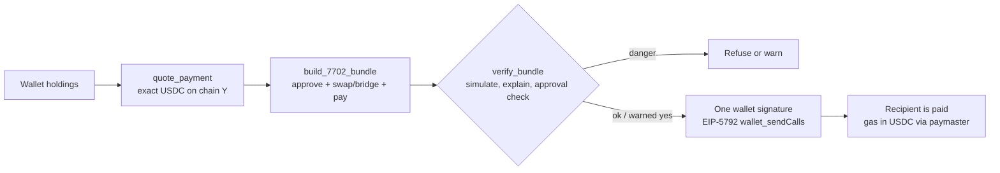

# SwapChan Roadmap: Staying Relevant

The product bet is EIP-7702 plus stablecoin payments: one signature to pay exact USDC on a chosen chain from whatever the wallet holds, with gas paid in USDC. Simulate, explain, and check approvals stay the required safety layer under that. This page is written against the 74 MCP tools on main and on the live server, not against a wish list.

## Contents

- [The bet](#the-bet)
- [Milestone 1 — one same-chain payment](#milestone-1--one-same-chain-payment)
- [What already exists](#what-already-exists)
- [Current MCP tools](#current-mcp-tools)
- [Gaps against the bet](#gaps-against-the-bet)
- [Proposed tools](#proposed-tools)
- [Ranked by impact](#ranked-by-impact)
- [Other audit findings](#other-audit-findings)
- [Sources](#sources)

## The bet

**One signature, exact USDC out, gas in USDC.**

SwapChan already compares routes and returns unsigned transactions. The gap that matters is turning that into a payment: pay X USDC on chain Y to Z, sourced from whatever the wallet holds, approve plus swap or bridge plus the payment in one EIP-7702 bundle, with gas sponsored in USDC. An agent can only offer that if the bundle is simulated, explained, and approval-checked before the wallet sees it. Human sign-off on that one signature stays the default.

EIP-7702 (Set code for EOAs) shipped in the Pectra upgrade on Ethereum mainnet on 7 May 2025, 10:05:11 UTC, epoch 364032. The Ethereum Foundation's announcement names the two capabilities this roadmap needs: atomic batching (approve and swap in one transaction) and gas sponsorship. 7702 itself is not a paymaster; a delegate plus a wallet API such as EIP-5792 `wallet_sendCalls` (which can carry a paymaster capability) is how those land in a wallet. I did not verify 7702 support on SwapChan's other eight EVM chains, so a bundle should be offered only on a chain that has been checked.

## Milestone 1 — one same-chain payment

**Integrated first payment, 24 November 2026.** At Base Sepolia block 63,156,739, the local SmartWallet page paid exactly 0.000001 USDC from a fresh Block Tools account with zero ETH and zero USDC. The funder exchanged 0.015793 of its 20 USDC for exactly 0.000061769863559573 WETH, delivered directly to the sender. The funder paid 0.000001163977650395 ETH across approval and funding. [Funding swap](https://sepolia.basescan.org/tx/0x515f7c36406a386e86a37913a29aa023736828caacc8440c5a0150ec6d28d389)

The browser ran the normal `/smartwallet` page with an automated disposable wallet. The controls were “Connect wallet”, “Get payment quote”, “First payment: import the signed Block Tools delegation” and “Review and sign in wallet”. The successful review showed a maximum WETH spend of 0.000061769863559573 and a maximum gas charge of 0.015590 USDC. The first payment required a chain-specific, nonce-zero delegation signature and one EIP-712 payment signature. The standalone Block Tools executable inspected the unsigned batch. The test wallet produced the signatures automatically with its locally derived key. An earlier test attempt produced the same delegation authorization and ended before signing a payment.

| Balance        |       Before payment |        After payment |
| -------------- | -------------------: | -------------------: |
| Sender ETH     |                    0 |                    0 |
| Sender WETH    | 0.000061769863559573 | 0.000000419128645934 |
| Sender USDC    |                    0 |             0.010723 |
| Recipient USDC |             0.000003 |             0.000004 |

The swap yielded 0.015591 USDC. The recipient received 0.000001 USDC and Pimlico charged 0.004867 USDC. SmartWallet displayed “View payment receipt”. UserOperation `0x765d8b2e29eb370c335afe294c11e4f1d2595814cbe2a260fe1f036d395ab9d6`. [Payment receipt](https://sepolia.basescan.org/tx/0x041ec7fac5c7cbcf428001f7d75aba0e2e46891e3c9dafece879f530c0dd5af8)

**Integrated repeat payment, 24 November 2026.** A local MCP client called `quote_payment`, `build_7702_bundle`, `submit_payment`, and `payment_status` against the live Base Sepolia API path. The review showed a payout of 0.000001 USDC, a maximum fee of 0.006996 USDC and zero WETH spend. Standalone Block Tools inspected the operation. The disposable test wallet signed one EIP-712 request automatically and reused its existing delegation. There were zero interactive prompts. The receipt recorded 0.000001 USDC paid and 0.002246 USDC charged by the paymaster. [Transaction receipt](https://sepolia.basescan.org/tx/0xb51044eb5158ee0e47e1ebeec2e19b392a8597248c0ab69ce906042626ba60e9)

| Balance        |               Before |                After |
| -------------- | -------------------: | -------------------: |
| Sender ETH     |                    0 |                    0 |
| Sender WETH    | 0.000018700416519787 | 0.000018700416519787 |
| Sender USDC    |             0.008387 |             0.006140 |
| Recipient USDC |             0.000002 |             0.000003 |

UserOperation `0xd95146b6e3d1539be4e4e385d77db365aced558b8d065a74c8eb02414b1f7b54`. This repeat used the already-delegated sender from the standalone proof below.

**Prerequisite in the standalone Block Tools project.** Before implementing the SwapChan payment path, land and test support for the signing formats it needs: the EIP-7702 delegation authorization and the selected wallet's ERC-4337 UserOperation. Include known-answer vectors for both and verify that changing the delegate, chain, payment calldata, or fee terms invalidates the corresponding signature. Use disposable Base Sepolia accounts for the end-to-end proof.

Start with one supported wallet, one EVM chain, one source token other than USDC, and one paymaster. The user starts with enough of the source token to cover the payment and fees, zero USDC, and zero native gas token. In SmartWallet they request an exact USDC payout on the same chain. Use 0.000001 USDC (one base unit) for the testnet acceptance run.

**Live protocol proof, November 24, 2026.** Both payments settled on Base Sepolia using Simple7702Account and Pimlico's ERC-20 paymaster. The sender held zero native ETH before and after both payments.

| Run                                                                                                                                    | Sender balances before → after                                      | Recipient USDC before → after | USDC gas charge | Sender signatures                               |
| -------------------------------------------------------------------------------------------------------------------------------------- | ------------------------------------------------------------------- | ----------------------------- | --------------: | ----------------------------------------------- |
| [First payment, block 63,144,963](https://sepolia.basescan.org/tx/0xaabcc6cffcbd810033b854d3f048723519d38f59e8fda1499d9574d5b72ea40e)  | WETH 0.000080000000000000 → 0.000018700416519787; USDC 0 → 0.010539 | 0 → 0.000001                  |        0.005038 | Delegation authorization and UserOperation      |
| [Repeat payment, block 63,145,375](https://sepolia.basescan.org/tx/0xce569ed6bf9a579e584504f70e32a369babd31016a0b95f65357ec0bca2e17ac) | WETH unchanged; USDC 0.010539 → 0.008387                            | 0.000001 → 0.000002           |        0.002151 | One UserOperation using the existing delegation |

Block Tools generated the disposable wallets. A noninteractive test signer produced the live payment signatures. The first swap yielded 0.015578 USDC, covering the payout and fee. The repeat used the remaining USDC directly. Both payment runs had zero interactive prompts. The integrated runs above exercise SmartWallet and MCP with a disposable signer. Production release still requires packaging the new Block Tools commands and deploying the tested Swapchan changes.

Run this acceptance test with a fresh wallet, then repeat it with the same wallet after delegation is in place. Record the wallet version, chain, quote, verification result, wallet prompts, and transaction receipt for each run.
1. **Quote.** Before the wallet prompts the user, show the chain, recipient, exact payout, maximum total source-token spend, and maximum USDC gas charge included in that spend. When starting from zero USDC, the swap must fund both the payout and the paymaster charge.
2. **Verify.** Check that the delegate is allowlisted and explain what permission persists and how to revoke it. Simulate the full batch and check the spender, exact approval, recipient, payout, and paymaster charge against the quote. A changed recipient, unknown delegate, charge above the cap, or failed simulation must stop the flow before signing.
3. **Count confirmations.** Record every wallet prompt and signature on each run, identifying delegation setup separately from payment approval. The repeat payment must require exactly one user signature. Claim one signature on the first payment only if the fresh-wallet run demonstrates it.
4. **Reconcile settlement.** Use the confirmed transaction and token balance changes to verify that the recipient gained the exact requested amount, the sender spent at most the quoted maximum, and the paymaster charged at most the displayed USDC cap. Both runs must succeed without a native-token top-up.

Ship this path once both runs meet those criteria. After release, track how many first-time payers complete a second payment within 30 days to test demand separately from technical correctness.

Cross-chain payments are a later milestone. Track the source transaction through destination settlement, show pending and refund outcomes, and mark a payment complete only after verifying the exact payout on the destination chain.

## What already exists

SwapChan already has a SmartWallet agent, and it already has most of the safety primitives a 7702 payment needs — just not wired as one unsigned bundle. All of the following was read in the repo at `9ecca307` and, for MCP tools, also seen on the live server.

| What                                       | Status         | Detail                                                                                                                                                                                                                                                                                                                                                                                                                                                                            |
| ------------------------------------------ | -------------- | --------------------------------------------------------------------------------------------------------------------------------------------------------------------------------------------------------------------------------------------------------------------------------------------------------------------------------------------------------------------------------------------------------------------------------------------------------------------------------- |
| swapchan.com/smartwallet                   | EOA only       | Hosted self-custody agent (Claude Agent SDK). It calls SwapChan MCP (`get_quote`, `build_swap_tx`, `verify_tx`) plus Morpho/Aave/Pendle read/build tools, then replies with a wallet action. The browser signs in the user's wallet. Keys never leave the wallet. SIWE is only to view chat history.                                                                                                                                                                              |
| One transaction per turn                   | Blocks 7702    | The agent's preface forbids bundling approve + swap. It must propose step 1, wait for settlement, then step 2. AppKit is pinned to regular accounts (`defaultAccountTypes.eip155 = eoa`), not Reown smart accounts. The `sign_and_send` payload is `{to, data, value, chainId, gas}` with no `authorizationList`.                                                                                                                                                                 |
| `verify_tx`                                | Safety layer   | Pre-sign calldata guard + `eth_simulateV1` (or Solana `simulateTransaction`). Flags unlimited approvals, unexpected spenders (including inside multicall and Safe), Permit2, `setApprovalForAll`, proxy upgrades, and EIP-7702. An `authorizationList` is a critical finding: the account would run another contract's code. A target whose code starts `0xef0100` is a warning that it is already a 7702 delegated account. Returns a plain-language summary for human sign-off. |
| `simulate_swap` and `build_swap_tx`        | Two signatures | `simulate_swap` dry-runs a quote (including its approval) or a raw tx and reports balance changes, gas, and reverts. `build_swap_tx` already returns a separate exact-amount unsigned approve when needed, `allowForeignRecipient` for a same-chain payout to someone other than the taker, and an `eth_call` or API simulation. If approval is still required, the swap simulation is skipped. `permit2` is currently always null.                                               |
| `rebalance_plan` and `get_wallet_balances` | Planner only   | Closest existing "from whatever I hold" tools. `rebalance_plan` takes target weights and returns a list of live-quoted swaps, each still a separate `build_swap_tx`. Balances already suggest de-risking to USDC. Neither tool delivers an exact amount of USDC to a recipient on a chosen chain in one signature.                                                                                                                                                                |
| `compare_routes` and CoW limits            | Partial        | `compare_routes` already ranks every provider, including CoW, by net USD received, and can compare same-chain vs cross-chain destinations. CoW limit orders are gasless for the user (solvers pay gas) but still need a prior approve and an EIP-712 signature, not a 7702 bundle. There is no tool that labels intent/solver vs classic routes.                                                                                                                                  |
| `bytecode_inspect` and blocktools          | Decode only    | `bytecode_inspect` classifies EIP-7702 delegations offline. blocktools can decode type-4 transactions (`authorizationList` included). Its signing path refuses type 4 with `eip7702_unsupported`, and refuses ERC-4337 / Barz user operations. There is no MCP tool that builds a type-4 transaction or a `wallet_sendCalls` batch.                                                                                                                                               |

Safety-layer status as of this audit:
- [x] Simulate before returning a tx — Exists for a single swap or raw tx. Missing for a 7702 bundle or paymaster.
- [x] Plain-English explanation — `verify_tx` summary for unsigned txs; `explain_transaction` for mined hashes. No bundle explainer. `describeTx` is not an MCP tool (blocktools wasm + API `describeTxCall` for recovery claims).
- [x] Approval safety check — `verify_tx`, `contract_approve_call`, `check_approvals`, exact-amount approve in `build_swap_tx`. Not applied to approve+swap+pay as one artifact.
- [ ] One-signature approve + swap/bridge + pay — SmartWallet forbids bundling. No type-4 builder. No pay tool.
- [ ] Gas paid in USDC via a paymaster — No paymaster, `quote_gas_in_token`, or sponsorship code in the repo.

## Current MCP tools

All 74 were read in `apps/mcp/src/tools.ts` at main `9ecca307` and observed live via `tools/list` on https://mcp.swapchan.com/mcp at 10:47 AM PST, Nov 24, 2026. The two lists match. Outputs are JSON plus `display` markdown unless noted. 15 swap nets: Ethereum, Base, Arbitrum, Optimism, Polygon, BNB, Avalanche, Linea, Scroll, Solana, Bitcoin, Tron, Litecoin, Dogecoin, Bitcoin Cash. CoW chains: Ethereum, Base, Arbitrum, Polygon, BNB, Avalanche, Linea. `broadcast_tx` covers 51 chains in `packages/shared/src/broadcast.ts`.

### Swap routing (10)

| Tool                   | Does                                                                                 | Inputs                                                            | Chains         |
| ---------------------- | ------------------------------------------------------------------------------------ | ----------------------------------------------------------------- | -------------- |
| `get_supported_chains` | List the 15 swap networks and their mascots                                          | none                                                              | 15 swap nets   |
| `get_supported_tokens` | Token list, optional chain or search                                                 | ?chainId, ?search                                                 | 15 swap nets   |
| `get_quote`            | Single best route by net USD after gas and fees                                      | from/to chain+token, ?amount, ?recipient, ?slippageBps, ?partner  | 15 swap nets   |
| `compare_routes`       | All routes ranked by net USD; optional extra destination chains                      | same as get_quote, ?alsoToChainIds, ?limit                        | 15 swap nets   |
| `build_swap_tx`        | Unsigned swap tx, exact-amount approve if needed, optional eth_call sim; never signs | quote fields + taker, ?provider, ?quoteId, ?allowForeignRecipient | 15 swap nets   |
| `get_route_status`     | pending / done / failed / not_found plus destination hash                            | provider, txHash, fromChainId, toChainId                          | 15 swap nets   |
| `get_utxo_deposit`     | THORChain vault, exact amount, required memo, minimum, expiry                        | from/to chain+token, amount, recipient, ?refund, ?slippageBps     | LTC, DOGE, BCH |
| `track_utxo_swap`      | Read-only THORChain swap progress by inbound txid                                    | txid                                                              | LTC, DOGE, BCH |
| `build_swap_link`      | Prefilled swapchan.com link, including a batch of items                              | ?from/to chain+token, ?amount, ?owner, ?recipient, ?ref, ?items   | 15 swap nets   |
| `build_send_tx`        | Unsigned native or token transfer for the user's wallet to sign                      | chain, to, amount, ?token, ?from                                  | per chain arg  |

### Limit orders (3)

| Tool                 | Does                                                                  | Inputs                                                                               | Chains     |
| -------------------- | --------------------------------------------------------------------- | ------------------------------------------------------------------------------------ | ---------- |
| `build_limit_order`  | Gasless CoW EIP-712 limit order plus approve tx if allowance is short | chainId, owner, sell/buy token, sellAmount, buyAmount or limitPrice, ?expiresInHours | CoW: 7 EVM |
| `list_limit_orders`  | A wallet's CoW orders and fill status                                 | chainId, owner                                                                       | CoW: 7 EVM |
| `cancel_limit_order` | EIP-712 cancellation typed data; never signs                          | chainId, uid                                                                         | CoW: 7 EVM |

### Discovery (7)

| Tool              | Does                                                               | Inputs                                                                 | Chains                                   |
| ----------------- | ------------------------------------------------------------------ | ---------------------------------------------------------------------- | ---------------------------------------- |
| `scan_new_tokens` | Newest pairs (GeckoTerminal + DexScreener), risk badge and swapUrl | ?chain, ?minLiquidityUsd, ?maxAgeHours, ?minVolumeUsd, ?window, ?limit | ETH, Base, BNB, SOL                      |
| `scan_trending`   | Trending and boosted tokens, risk badge and swapUrl                | same as scan_new_tokens                                                | ETH, Base, BNB, SOL                      |
| `scan_movers`     | Biggest absolute price change over a window                        | same as scan_new_tokens                                                | ETH, Base, BNB, SOL                      |
| `token_risk`      | Honeypot, tax, authorities, LP, liquidity/age/FDV; level + flags   | chain, address                                                         | ETH, Base, BNB, SOL, Arb, Poly, OP, Avax |
| `token_info`      | On-chain metadata, price, holders, plus the full token_risk check  | chainId, address                                                       | EVM or Solana                            |
| `token_pools`     | Where a token trades and how deep the pools are                    | chainId, address                                                       | EVM or Solana                            |
| `whale_watch`     | Largest holders and recent large moves                             | chainId, address, ?minUsd                                              | EVM or Solana                            |

### Wallet and market (21)

| Tool                  | Does                                                                                   | Inputs                                                | Chains                                          |
| --------------------- | -------------------------------------------------------------------------------------- | ----------------------------------------------------- | ----------------------------------------------- |
| `get_wallet_balances` | Multi-chain portfolio, USD prices, suggestions including de-risk to USDC               | address, ?chains                                      | 9 EVM, SOL, BTC, TRON                           |
| `find_money`          | Headline scanner: unclaimed, idle, lending, dust, risky approvals, unsigned recoveries | address, ?fresh                                       | broad (EVM, forks, SOL, TRON, BTC family, more) |
| `find_money_batch`    | find_money across a pasted list of wallets                                             | addresses                                             | same as find_money                              |
| `find_money_status`   | Poll a find_money_batch job                                                            | jobId                                                 | same as find_money                              |
| `check_approvals`     | Live ERC-20 allowances, risk flags, unsigned revoke txs                                | owner, chainId                                        | one EVM chain                                   |
| `build_revoke_tx`     | Unsigned approve(spender, 0)                                                           | chainId, token, spender                               | EVM                                             |
| `wallet_history`      | Recent swaps for an EVM or Solana wallet                                               | address, ?chainId                                     | EVM, Solana                                     |
| `wallet_pnl`          | Average-cost PnL estimate                                                              | address, ?chainId                                     | EVM, Solana                                     |
| `airdrop_check`       | Merkl rewards and legacy unclaimed contracts                                           | address                                               | listed EVM, SOL, TRON                           |
| `rebalance_plan`      | Target weights in, a list of live-quoted swaps out                                     | address, targets, ?minTradeUsd                        | 15 swap nets                                    |
| `get_yields`          | DefiLlama yields; SwapChan link to the deposit token                                   | ?asset, ?chainId, ?minTvlUsd, ?stablecoinOnly, ?limit | SwapChan chains in DefiLlama                    |
| `watch_token`         | Pull-based price and route watchlist under a watchId                                   | watchId, items                                        | watched tokens                                  |
| `list_watches`        | Show a watchlist                                                                       | watchId                                               | watched tokens                                  |
| `check_watches`       | Which thresholds or better routes triggered                                            | watchId                                               | watched tokens                                  |
| `unwatch_token`       | Remove one item or the whole list                                                      | watchId, ?itemId                                      | watched tokens                                  |
| `resolve_name`        | ENS, Basename, SNS, and reverse lookup                                                 | name                                                  | ETH, Base, Solana                               |
| `price_history`       | Historical USD price from DefiLlama, not the live price                                | coin, date, ?days                                     | DefiLlama ids / tickers                         |
| `get_gas`             | Current fees on SwapChan chains, USD cost of a typical swap                            | ?chains, ?history                                     | EVM, SOL, BTC, TRON                             |
| `best_time_to_swap`   | Base-fee percentiles and cheapest hour of the day                                      | ?chainId                                              | EVM                                             |
| `market_context`      | Fear and greed, funding, OI, stablecoin supply, DeFi TVL                               | none                                                  | market-wide                                     |
| `bridge_doctor`       | Stuck-bridge status across LI.FI, Across, Relay, deBridge, THORChain                   | hash, ?fromChainId                                    | those bridges                                   |

### Safety (7)

| Tool                  | Does                                                                                   | Inputs                         | Chains              |
| --------------------- | -------------------------------------------------------------------------------------- | ------------------------------ | ------------------- |
| `explain_transaction` | Plain-English decode of a mined tx; summary + explorer link                            | chainId, hash                  | EVM, SOL, BTC, TRON |
| `simulate_swap`       | Fork dry-run (`eth_simulateV1` or Solana `simulateTransaction`): balances, gas, revert | quoteId+taker or raw tx        | EVM, Solana         |
| `verify_tx`           | Pre-sign verdict ok/caution/danger: approvals, 7702, minOut, simulation, summary       | chainId, tx, ?expected         | EVM, SOL, TRON      |
| `broadcast_tx`        | Relay already-signed bytes unchanged; optional strict verify and Flashbots             | chainId, tx, ?private, ?strict | 51 broadcast nets   |
| `tx_status`           | confirmed / pending / failed / not-found for a hash                                    | chainId, hash                  | EVM, SOL, TRON, BTC |
| `signing_guide`       | In-context playbook: recover keys offline, verify_tx, human signs every tx             | ?chain, ?situation             | EVM, SOL, TRON      |
| `recovery_guide`      | Local offline key-recovery playbook; no secrets leave the machine                      | ?situation                     | guide               |

### Contracts (7)

| Tool                      | Does                                                                             | Inputs                                                       | Chains              |
| ------------------------- | -------------------------------------------------------------------------------- | ------------------------------------------------------------ | ------------------- |
| `read_chain`              | Generic read-only chain state (balances, calls, storage, logs, blocks)           | chainId, op, plus op-specific fields                         | EVM, SOL, TRON, BTC |
| `contract_reader`         | Verified source, proxy, owner powers in plain English                            | chainId, address                                             | EVM                 |
| `contract_abi`            | ABI from Sourcify / Etherscan, proxies followed                                  | chainId, address, ?abi                                       | EVM                 |
| `contract_read`           | eth_call a view function; revert is an error, never a zero                       | chainId, address, function, ?args, ?abi                      | EVM                 |
| `contract_encode_call`    | Unsigned calldata + decoded view; nothing sent                                   | chainId, address, function, ?args, ?value, ?abi              | EVM                 |
| `contract_approve_call`   | Pre-sign ABI + verifyTx check of one call (unlimited approve refused by default) | chainId, address, function, ?args, ?expect_spender/amount, … | EVM                 |
| `contract_build_creation` | Unsigned contract creation, initcode hash, predicted address                     | chainId, bytecode, ?abi, ?args, ?value, ?from, ?createHash   | EVM                 |

### Dev tools (18)

| Tool                       | Does                                                                          | Inputs                                               | Chains                     |
| -------------------------- | ----------------------------------------------------------------------------- | ---------------------------------------------------- | -------------------------- |
| `address_tool`             | Detect, validate, convert, or script an address                               | op, plus format fields                               | dev / many families        |
| `xpub_addresses`           | Derive receive/change addresses from an xpub                                  | xpub, chain, ?kind, ?branch, ?start, ?count          | UTXO                       |
| `solana_address`           | PDA, ATA, on-curve, Anchor discriminator                                      | op, plus seeds/owner/mint                            | Solana                     |
| `substrate_tool`           | SS58, storage keys, hashes                                                    | op, plus address/data fields                         | Polkadot / Substrate       |
| `hash_tool`                | BLAKE2b, twox128, Base58                                                      | op, ?data, ?out_len, ?personal, ?text                | offline                    |
| `chain_params`             | UTXO chain parameter table                                                    | ?chain                                               | UTXO table                 |
| `tron_tx`                  | Decode Tron raw_data or compute txid                                          | op, hex                                              | Tron                       |
| `multisig_address`         | Bitcoin m-of-n P2WSH address                                                  | threshold, pubkeys, ?network                         | Bitcoin                    |
| `taproot_multisig_address` | Bitcoin Taproot m-of-n address                                                | threshold, pubkeys, ?network                         | Bitcoin                    |
| `combine_psbts`            | Combine cosigner PSBTs and finalize                                           | psbts                                                | Bitcoin-family             |
| `build_plan_tx`            | Resolve a transaction Plan to unsigned bytes                                  | plan, ?context                                       | plan-dependent             |
| `msg_verify`               | Verify a signed message                                                       | address, message, sig, ?chain, ?format, ?pubkey      | per format                 |
| `bolt11_decode`            | Decode a BOLT11 Lightning invoice                                             | invoice                                              | Lightning                  |
| `evm_abi`                  | ABI encode, decode, inspect                                                   | op, ?sig, ?args, ?input, ?abi, ?types, ?output       | EVM                        |
| `create_address`           | CREATE / CREATE2 address                                                      | deployer, ?nonce, ?salt, ?init_code_hash, ?init_code | EVM                        |
| `bytecode_inspect`         | Classify runtime code: EIP-1167, EIP-7702 delegation, EOF, size, metadata     | code                                                 | EVM, offline               |
| `typed_data_verify`        | EIP-712 hash / signer check, including permit spender and amount expectations | typed_data, ?signature, ?signer, ?expect_*           | EVM                        |
| `supported_chains`         | Dev-tool chain table: verified vs unverified                                  | ?chain                                               | blocktools table (80 rows) |

### Guides (1)

| Tool                | Does                                                              | Inputs           | Chains |
| ------------------- | ----------------------------------------------------------------- | ---------------- | ------ |
| `swapchan_playbook` | Start here: principles and workflows that compose the other tools | ?workflow, ?full | n/a    |

## Gaps against the bet

### EIP-7702 and stablecoin payments

This is the centerpiece. Routing, exact-amount approvals, a same-chain foreign recipient flag, a multi-leg rebalance planner, and pre-sign verification already exist. What does not exist is a single unsigned artifact that does the payment.

Missing: a type-4 / `wallet_sendCalls` builder; a paymaster so gas can be paid in USDC; a tool that starts from 'pay X USDC on chain Y' and chooses source holdings; simulation and explanation of the whole bundle, including the 7702 delegate and the paymaster; SmartWallet changes so the agent can propose that one signature instead of two turns. Until those exist, an agent still walks a user through approve, then swap, then a transfer, and the user must hold the destination gas token.

### Agent-safe execution

The safety layer is largely built for one transaction. `verify_tx`, `simulate_swap`, `contract_approve_call`, and the SmartWallet rule 'verify, then the user signs' should stay mandatory, and be extended to the bundle: same expected recipient and minOut checks, plus 'is this delegate allowlisted?', 'is the approval exact and inside the batch?', and 'what the paymaster will pull'. `signing_guide` already mentions EIP-7702 session keys only as an advanced option; default remains human sign-off on every signature, now one signature instead of several.

### Intents and solvers

`compare_routes` already ranks CoW and the classic aggregators by net USD received, which is the comparison that matters. The local MCP tools now label signed solver orders, router swaps, bridge transactions, and explicitly declared native swap transactions. Use `compare_intents` for that comparison. The execution label describes the wallet action; a bridge may also use solvers internally. CoW still needs a separate approve and cannot be the 7702 payment path until it is either bundled or used only when it wins on net proceeds.

### Chain abstraction

Swap routing already covers 15 networks, including native BTC/LTC/DOGE/BCH through THORChain and Solana through Jupiter and the other routers. `find_money` and `broadcast_tx` go wider. The payment tool should sit on top of that: source from those holdings, settle USDC on an EVM chain (or Solana when a corresponding one-signature path exists). 7702 bundles themselves are EVM-only; THOR and Solana legs stay as today (PSBT, memo deposit, or a Solana tx) and should be called out when a payment cannot be one signature.

## Proposed tools

New or changed MCP tools only, plus the SmartWallet change that makes them usable in the hosted agent. Effort is rough: S days, M a short project, L a multi-week build including wallet and paymaster work. The Base Sepolia milestone implements limited payment quoting, bundle building and SmartWallet signing. The local MCP exposes the same paymaster fee caps as the payment quote through `quote_gas_in_token` on Base Sepolia. It also implements `compare_intents` and the Base Sepolia version of `check_7702_delegation`. The latter inspects current and proposed delegate runtime code at a single block and returns the nonce and zero address for revocation. Payment construction independently repeats the runtime check before returning a signing request. The table gives the full target for each capability.

| Tool                    | Spec                                                                                                                                                                                                                                       | Builds on                                                                     | Effort |
| ----------------------- | ------------------------------------------------------------------------------------------------------------------------------------------------------------------------------------------------------------------------------------------ | ----------------------------------------------------------------------------- | ------ |
| `pay`                   | Pay X of token T on chain Y to a recipient from this wallet. Chooses source holdings, quotes, builds the 7702 bundle, and refuses to return it unless `verify_bundle` is ok or the user has accepted a warn.                               | `get_wallet_balances`, `get_quote`, `allowForeignRecipient`, `rebalance_plan` | L      |
| `build_7702_bundle`     | Pack approve + swap/bridge + pay into one EIP-7702 authorization and an EIP-5792 `wallet_sendCalls` batch (`atomicRequired`). Unsigned only. Include the delegate address and how to revoke.                                               | `build_swap_tx` approval + unsignedTx                                         | L      |
| `verify_bundle`         | Required safety layer: simulate the whole batch, check exact approvals and recipient/minOut, inspect the 7702 delegate, and explain the paymaster pull in plain English. Verdict ok / caution / danger.                                    | `verify_tx`, `simulate_swap`, `bytecode_inspect`                              | M      |
| `quote_payment`         | Cheapest way to deliver an exact amount on the destination chain from current holdings, net of swap fees and gas-in-token. No transaction.                                                                                                 | `compare_routes`, `rebalance_plan`                                            | M      |
| `quote_gas_in_token`    | Quote paying the bundle's gas in USDC (or another token) via a paymaster, and fold that cost into `quote_payment`.                                                                                                                         | nothing in-repo                                                               | M      |
| `compare_intents`       | Same net-USD ranking as `compare_routes`, with each row labeled intent/solver vs classic router, so an agent can say which mechanism won.                                                                                                  | `compare_routes`, CoW `execution=order`                                       | S      |
| `check_7702_delegation` | What code a 7702 authorization would attach, whether the delegate is known, session-key scope, and the revoke authorization. Also a pre-check on existing `0xef0100` code.                                                                 | `bytecode_inspect`, `verify_tx` eip7702 findings                              | S      |
| SmartWallet (product)   | Not an MCP tool. Lift the one-tx-per-turn rule for a verified bundle; accept `authorizationList` or `wallet_sendCalls`; stop forcing EOA-only AppKit on 7702-capable chains. Keep human sign-off as the default; auto-send stays advanced. | `/smartwallet`, `wallet_respond`, `verify_tx`                                 | L      |

## Ranked by impact

These ranks describe product impact. For the first milestone, implement quoting, delegate checks, bundle verification, and the SmartWallet signing path together for the single supported payment above.

| Rank | Work                                   | Why it comes first                                                                                                           | Effort |
| ---: | -------------------------------------- | ---------------------------------------------------------------------------------------------------------------------------- | ------ |
|    1 | `pay` + `build_7702_bundle`            | This is the product: one-signature exact payout from whatever the wallet holds. Everything else is in service of it.         | L      |
|    2 | `verify_bundle`                        | Without it, an agent cannot safely return a 7702 payment. Ship it as a gate on `pay`, not as an optional follow-up.          | M      |
|    3 | SmartWallet one-signature path         | The hosted agent is already the place users will ask to pay someone. Today it is hard-wired to two (or more) EOA signatures. | L      |
|    4 | `quote_payment` + `quote_gas_in_token` | Makes the payment exact and lets the user avoid holding the gas token. Needed for the USDC-gas claim to be true.             | M      |
|    5 | `check_7702_delegation`                | Small, and it makes the delegate choice inspectable before anyone signs away account code.                                   | S      |
|    6 | `compare_intents`                      | Useful labeling on a comparison that already works. Do not block the payment work on it.                                     | S      |

## Other audit findings

|                      |                                                                                                                                                                                                                                                                                                                                                                                                             |
| -------------------- | ----------------------------------------------------------------------------------------------------------------------------------------------------------------------------------------------------------------------------------------------------------------------------------------------------------------------------------------------------------------------------------------------------------- |
| Repo audited         | github.com/TSavo/swapchan main `9ecca307` (shallow clone, read-only)                                                                                                                                                                                                                                                                                                                                        |
| Live MCP             | https://mcp.swapchan.com/mcp — initialize + `tools/list`, HTTP 200 from this box at 10:47 AM PST, Nov 24, 2026. serverInfo version 0.3.0. 74 tools, same names as main.                                                                                                                                                                                                                                     |
| Live API health      | https://api.swapchan.com/health — version 1, providers: lifi, 0x, cow, velora, across, relay, jupiter, kyberswap, 1inch, debridge, thorchain.                                                                                                                                                                                                                                                               |
| apps/mcp README      | Stale: still lists only 11 tools. The root README and the live playbook are closer to the real catalog.                                                                                                                                                                                                                                                                                                     |
| Read-only tool pages | Coded in the web app: `/tools` hub, `/simulate` (`simulate_swap`), `/dashboard` (`find_money`), `/wallet`, `/token`, `/contract`, `/read-chain`, `/airdrops`, `/market`, `/rebalance`, `/bridge-status`, `/gas`, `/tools/contract`, `/scanner`, plus `/tools/<slug>` dev pages and `/smartwallet`. A GET of several of those URLs from this box returned HTTP 307 (redirect); pages were not rendered here. |
| describeTx           | Not an MCP tool. blocktools wasm documents `describeTx`; the API has `describeTxCall` for recovery/claim txs. User-facing stand-ins are `verify_tx` (unsigned) and `explain_transaction` (mined hash).                                                                                                                                                                                                      |
| permit2              | `build_swap_tx` still returns `permit2: null`. Typed-data permits are out of scope for the current SmartWallet agent, which cannot sign messages.                                                                                                                                                                                                                                                           |

## Sources

- [Pectra mainnet announcement (EIP-7702, batching, gas sponsorship)](https://blog.ethereum.org/2025/04/23/pectra-mainnet) — blog.ethereum.org, Apr 23, 2025
- [Pectra upgrade page (activated 7 May 2025, epoch 364032)](https://ethereum.org/roadmap/pectra/) — ethereum.org, updated Oct 16, 2026
- [EIP-7702: Set EOA account code](https://eips.ethereum.org/EIPS/eip-7702) — eips.ethereum.org
- [EIP-5792: Wallet Call API (`wallet_sendCalls`, paymaster capability)](https://eips.ethereum.org/EIPS/eip-5792) — eips.ethereum.org
- [SwapChan repo](https://github.com/TSavo/swapchan) — github.com
- [Hosted MCP endpoint](https://mcp.swapchan.com/mcp) — mcp.swapchan.com
